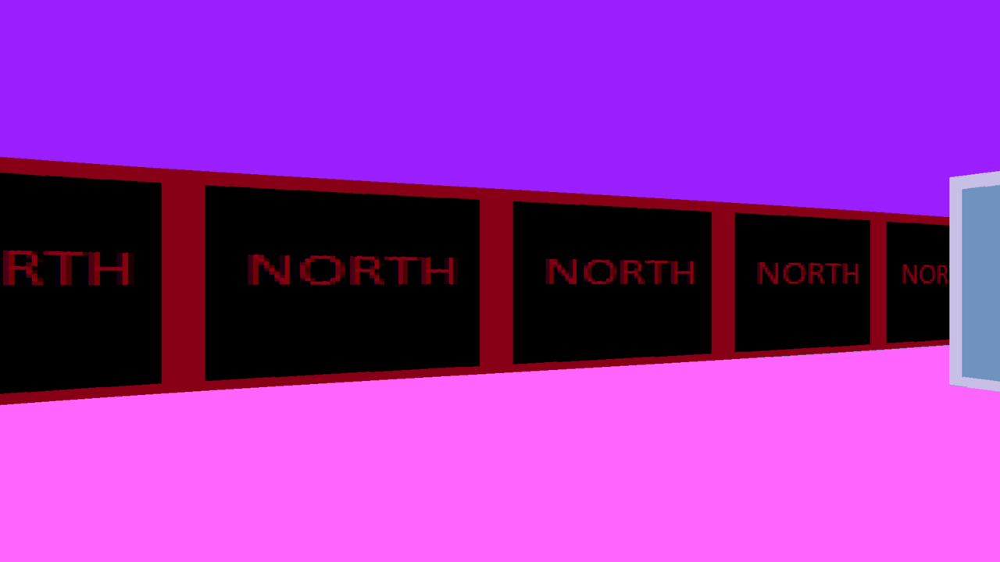
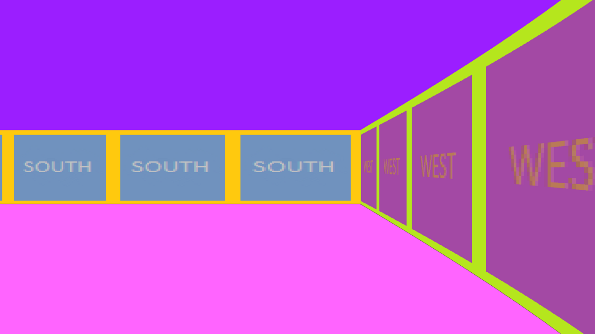

# cub3D

A small 3D engine in C that draws a maze from a `.cub` map file using raycasting, in the style of Wolfenstein 3D.

Group project for Hive Helsinki (School 42 network). Video demo: https://youtu.be/dwAx6tYZXvQ

## What it does

- Reads a `.cub` map file and checks it. Bad files print an error and exit.
- Casts one ray per screen column (1920 columns, 1080 rows, 60 degree field of view).
- Finds the wall for each ray by stepping along the map grid lines. It runs one horizontal pass and one vertical pass per ray and keeps the nearer hit. Tiles are 64 units wide.
- Corrects fish-eye distortion before it sizes the wall slice.
- Draws a different PNG texture on each wall side (north, south, east, west).
- Fills the ceiling and floor with the colours from the map file.

## Controls

| Key | Action |
| --- | --- |
| W / S | Move forward / backward |
| A / D | Strafe left / right |
| Left / Right arrow | Turn left / right |
| Esc | Quit |

There is no wall collision, so you can walk into a wall.



## Map file format

A `.cub` file has texture paths, two colours, then the map. The program only accepts files that end in `.cub`.

```
NO ../tilesets/cub3d_new_pngs/north.png
SO ../tilesets/cub3d_new_pngs/south.png
WE ../tilesets/cub3d_new_pngs/west.png
EA ../tilesets/cub3d_new_pngs/east.png
F 255,100,255
C 155,30,255

1111111111111111
10000000000000001
10001000000010001
10000000010000001
10001000000010001
100000000000000N1
 111111111111111
```

- `NO`, `SO`, `WE`, `EA`: path to a PNG for that wall. Each may appear once.
- `F`, `C`: floor and ceiling colour as `R,G,B`, each 0 to 255.
- Map characters: `1` wall, `0` floor, space (outside), and one of `N`, `S`, `E`, `W` for the start position and facing.
- The map needs exactly one start and no empty lines inside it. Maps with openings or islands are rejected.

`first_attempt/maps/` has 20 maps. `valid.cub` works. The others break one rule each, for example `missing_north.cub`, `island.cub`, `no_start_pos.cub` and `floor_color_minus.cub`. They test the parser. Each prints `Error` and a message, for example:

```
$ ./cub3d maps/missing_north.cub
Error
Incorrect or missing map lines
$ ./cub3d maps/island.cub
Error
Islands in the map are not allowed
$ ./cub3d maps/no_start_pos.cub
Error
Exactly one starting position marker required
```

The exit code is 0 even on error.

## Build and run

Needs a C compiler, `make`, `cmake`, and GLFW 3 with its development headers. On Debian or Ubuntu:

```
sudo apt install build-essential cmake libglfw3-dev xorg-dev
```

```
cd first_attempt
make
./cub3d maps/valid.cub
```

The Makefile has a `-L/Users/$USER/.brew/...` path for the 42 Mac setup. On Linux the missing directory is ignored, so nothing needs editing. Tested on Ubuntu 24.04 with GCC 13, cmake 3.28 and the system GLFW. The window opens at 1920x1080; without a GPU, Mesa software rendering is enough.



Run it from `first_attempt/`. The texture paths in the maps are relative to that folder.

Other targets: `make clean`, `make fclean`, `make re`. The build compiles the bundled MLX42 with cmake and libft with its own Makefile.

## Layout

```
first_attempt/
  source_files/          main loop, player control, ray maths, texture loading
  source_files/parsing/  .cub parser and map checks
  headers/cub3d.h
  maps/                  20 test maps
  other_libraries/       vendored MLX42 (2.3.4) and libft
  Doxygen_files/         generated docs (HTML)
tilesets/                PNG textures
testing_zone/            early raycasting and maths experiments
```

MLX42 is a third-party graphics library, copied into the repo. It is not our code. libft is our own school library.

## Authors

Three people worked on it. Commit counts from `git shortlog` (Armin appears under two names):

- Armin Kuburas: 91 of 119 commits (about 76%). Window and render loop, ray maths, player controls, texture and colour loading, and much of the parsing and test maps.
- Andrey Kovalevskiy: 19 commits.
- [Monsieur-Verdoux](https://github.com/Monsieur-Verdoux): 9 commits.

Commit counts do not measure the work exactly.
